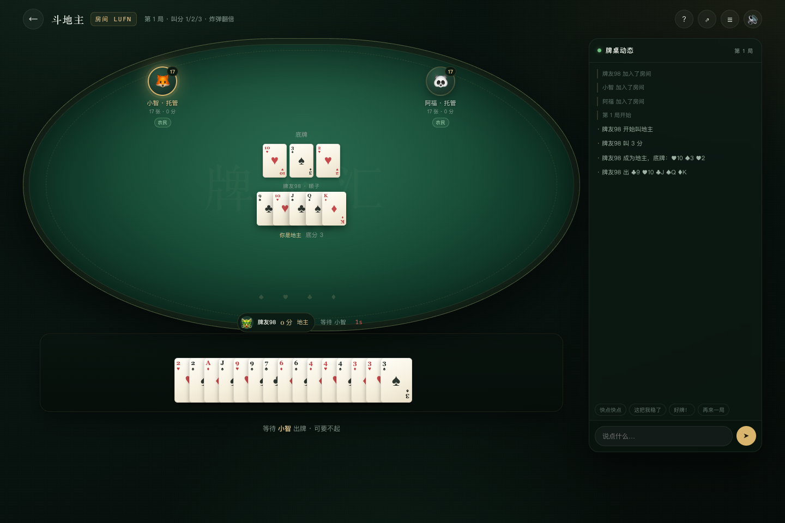
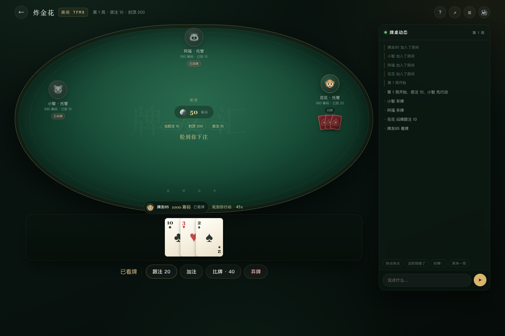
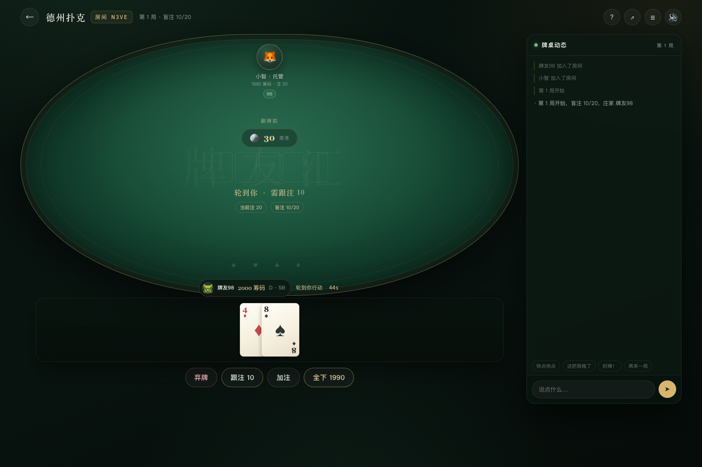
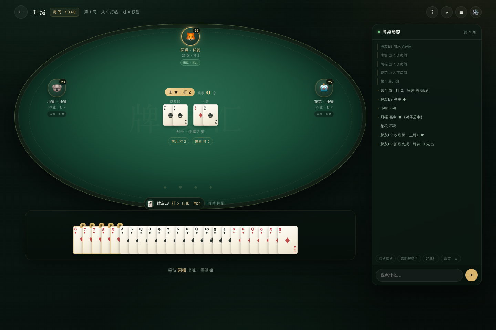
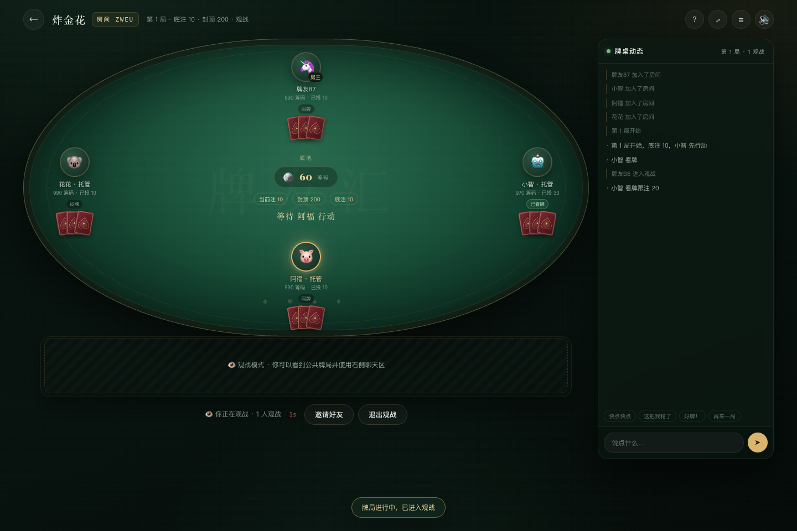
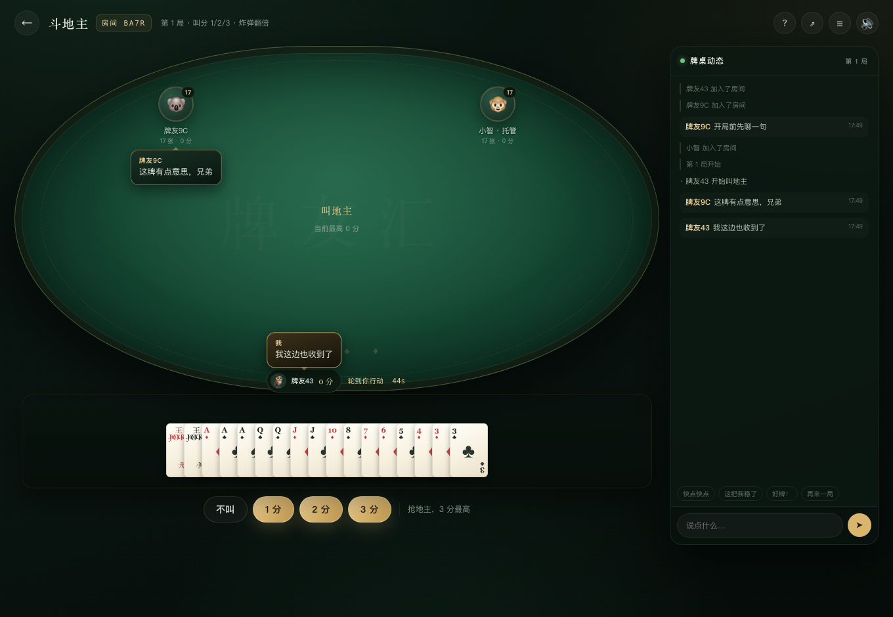

# 牌友汇 · 局域网扑克游戏大杂烩

同一 Wi-Fi 下，打开网页就能开桌。斗地主、炸金花、德州扑克、升级，一款服务端全部搞定。

- **零依赖**：只用 Node.js 标准库，不需要 `npm install`
- **四款玩法**：三人斗地主、3–6 人炸金花、2–8 人无限注德州、四人两队升级
- **局域网联机**：房间号 / 邀请链接 / 手机浏览器直接加入
- **服务端裁判**：洗牌、发牌、牌型校验、边池、计分全部在服务端，客户端看不到别人的手牌
- **观战 + 聊天**：牌局开始后仍可通过房号/邀请链接进入观战，看到公共牌局并聊天；有空位时可参与游戏
- **断线重连 + 托管**：掉线保留座位，60 秒未回来自动机器人托管
- **机器人陪练**：人不够时加机器人，一个人也能开局


## 目录

- [快速开始](#快速开始)
- [局域网联机](#局域网联机)
- [能玩什么](#能玩什么)
- [操作说明](#操作说明)
- [规则与实现口径](#规则与实现口径)
- [技术架构](#技术架构)
- [测试](#测试)
- [素材](#素材)
- [已知限制](#已知限制)
- [规则参考](#规则参考)

## 快速开始

要求：Node.js **18+**（运行游戏；开发环境为 Node 26）。端到端测试 `npm run test:ws` 使用 Node 内置 WebSocket，需要 Node 22+。无需数据库、无需构建、无需安装依赖。

```bash
cd /path/to/paiyouhui
npm start
```

看到下面的输出即可：

```text
♠ ♥  牌友汇 · 局域网牌局  ♣ ♦
本机：   http://localhost:3000
局域网： http://192.168.x.x:3000
```

浏览器打开 `http://localhost:3000`，点击「开一桌」，选择玩法；人不够就点「添加机器人」。

换端口：

```bash
PORT=3100 npm start
```

## 局域网联机

1. 电脑与手机连接**同一个 Wi-Fi**；
2. 电脑运行 `npm start`；
3. 查看终端里的「局域网」地址，或运行 `npm run lan`；
4. 手机浏览器打开 `http://电脑IP:3000`；
5. 建房后把 **4 位房号** 或邀请链接发给朋友；朋友也可以在大厅输入房号加入。

注意事项：

- 如果手机打不开，先确认 IP 是否为电脑当前 Wi-Fi 的网卡地址（VPN、虚拟机、Tailscale 会额外列出地址），并在系统防火墙中允许 Node 进程。
- 每位玩家使用**独立设备/浏览器**。同一浏览器的多个标签页共享身份，会被服务端视为同一玩家。
- 游戏数据只在这台电脑内存中流转，不经过外网；服务重启后房间和积分会清空。
- 本项目是本地娱乐项目，**不涉及真钱**、不提供充值或提现。

## 能玩什么

| 游戏 | 人数 | 核心机制 | 状态 |
| --- | --- | --- | --- |
| 斗地主 | 3 | 叫分抢地主、标准牌型、炸弹/王炸翻倍、春天 | ✅ 完整 |
| 炸金花 | 3–6 | 闷牌/看牌、跟注、加注、比牌、豹子/顺金/金花/顺子/对子/单张 | ✅ 完整（含边池） |
| 德州扑克 | 2–8 | 盲注、翻牌前/翻牌/转牌/河牌、全下、边池、7 选 5 | ✅ 完整 |
| 升级（拖拉机） | 4 | 亮主/反主、扣底、级牌、拖拉机、闲家 80 分、打级过 A | ✅ 可玩（简化，见下） |
| 观战 | 每房最多 20 人 | 公共牌局、聊天、空位入座 | ✅ 新增 |

截图：

| 斗地主 | 炸金花 |
| --- | --- |
|  |  |

| 德州扑克 | 升级 |
| --- | --- |
|  |  |

观战视角（不会看到任何人的未公开手牌）：



## 操作说明

### 大厅

- 修改昵称/头像：点击右上角自己的名牌。
- 创建房间：顶部「创建牌局」或任意玩法卡片。
- 加入：输入 4 位房号，或点房间列表的「加入」。
- 快速加入：自动进入第一个可加入的房间；没有可加入的房间时会尝试观战。
- 观战：每个房间右侧都有「观战」；牌局进行中/满员时，输入房号或点邀请链接会自动进入观战。
- 手机端：顶部 `☰` 打开牌桌动态与聊天抽屉。

### 房间

- 房主：添加/移除机器人、开始游戏、下一局。
- 其他玩家：准备/取消准备。
- 邀请：右上角 `⇗` 或点击房号，复制局域网邀请链接。
- 聊天：右侧输入框；预设快捷语在输入框上方。发言会以气泡形式在牌桌对应座位旁显示约 3 秒，观战者发言显示在牌桌边缘；右侧动态区保留完整记录。
- 离开：左上角返回。进行中离开会把座位交给机器人托管，避免其余玩家卡住；观战者离开只会移除观战席。
- 观战者：可以看公共牌局、发聊天；不能出牌/准备/开始。牌桌空位且不在牌局中时，可点「参与游戏」入座。
- 筹码：德州 / 炸金花不自动补码，筹码输光的玩家在**本局结算后**自动转入观战席；牌桌有空位时可重新入座（重新买入）。若只剩一人（或不足最低人数）还有筹码，本场停在结算页并提示，剩余玩家保留筹码，等待观战席重新入座或房主添加机器人。斗地主 / 升级没有筹码，正常结算后准备下一局。



### 出牌

- 选牌（斗地主 / 升级）：单击选/取消；按住一张牌横向滑动，划过多少选多少，拖回去会撤销；从已选中的牌起滑则是整段取消。轻点手牌外空白处、按 `Esc` 或点「重选」清空。
- 电脑端：`Shift` + 单击，可以连选上次点击位置到当前牌之间的一段。
- 手牌会按屏幕宽度自动收紧牌距，整手牌尽量在一屏内看全，不用左右滚动；手机上升级牌数较多时会自动分成两行，每张牌露出更多，也更好点。
- 斗地主：选牌后操作栏会实时显示牌型（如「顺子 · 5 张」），牌型不合法会提示；「提示」自动选一手能压过的牌，没有可压的牌时提示为空。
- 升级扣底：滑选或点选正好 8 张后点「确认扣底」，超过 8 张会被拦下。
- 德州/炸金花：下注滑杆 + 快捷比例按钮；「全下」二次确认。
- 每个操作都有 45 秒倒计时；超时会自动不出/弃牌/过牌/扣底。机器人约 0.9 秒行动。

## 规则与实现口径

> 规则来自公开资料的常见玩法，代码与界面为独立实现。不同地区规则有差异，本项目选择一套自洽、适合朋友局的统一口径。

### 斗地主（三人）

- 54 张牌，每人 17 张，留 3 张底牌。
- 叫分 1/2/3，最高者当地主并获得底牌；三家不叫自动重发。
- 牌型：单张、对子、三张、三带一/二、顺子（≥5）、连对（≥3 对）、飞机（可带单/带对）、四带二、炸弹、王炸。
- 炸弹/王炸每个倍数 ×2；春天/反春天 ×2；底分 = 叫分。
- 地主赢拿 2 份，农民各输 1 份；农民赢反之。

实现细节：飞机带单/带对的翅膀按“剩余牌可任意拆分”处理；四带二按 4+2 单张、4+2 对子识别；四带二不是炸弹。

### 炸金花（3–6 人）

- 52 张无王，每人 3 张，先交底注。
- 闷牌跟注 = 当前注；看牌后跟注 = 2 × 当前注。
- 加注提高当前注，封顶后不能再加。
- 比牌费用：闷牌 2 × 当前注，看牌 4 × 当前注；输者弃牌；**牌型相同，主动比牌者输**。
- 牌型：豹子 > 顺金 > 金花 > 顺子 > 对子 > 单张；A23 为最小顺子。
- 只剩一人、全员无法继续下注或达到 80 次行动时结束；全下按投入分层建边池。

实现细节：没有“235 特殊牌型”；比牌只记录胜者牌型，摊牌时展示未弃牌手牌；不自动补码，筹码耗尽的玩家在本局结束后自动转入观战席，可在空位重新入座（重新买入）。

### 德州扑克（2–8 人）

- 标准无限注：庄家按钮轮转，小盲/大盲；每人 2 张底牌 + 5 张公共牌。
- 四轮下注：翻牌前 → 翻牌 3 张 → 转牌 1 张 → 河牌 1 张；每轮从庄家左侧开始。
- 可过牌、跟注、加注、全下、弃牌；最小加注为一个大盲或上一次完整加注额。
- 全下按投入分层建立边池，摊牌时 7 选 5 比较；平分底池的余数按庄家左侧顺序分配。
- 牌型：同花顺 > 四条 > 葫芦 > 同花 > 顺子 > 三条 > 两对 > 一对 > 高牌；A2345 为最小顺子。

实现细节：不自动补码，筹码耗尽的玩家自动转入观战席；500 次行动保护；短码全下不会错误地重新打开加注；只剩一名有筹码的玩家时，必须先跟注/弃牌，不能跳过其决策直接摊牌。

### 升级 / 拖拉机（四人两队）

- 两副牌 108 张，南北 vs 东西，从 2 打起，过 A 获胜。
- 亮主：持有级牌可亮对应花色；对子级牌可反主；两张王可亮无主（对子级牌定主后不可再反无主）。
- 庄家收 8 张底牌，再扣 8 张；闲家赢最后一墩，底牌分数 ×2 计入闲家。
- 级牌、王、主花色为将牌；牌型支持单张、对子、拖拉机（连续对子）。
- 跟牌：有该花色必须跟；有同型牌必须出同型；该花色不够时全部跟出，可垫其他牌。
- 5 计 5 分，10/K 各计 10 分；闲家 ≥80 分下庄并升级，否则庄家升级。
- 0 分庄家 +3 级；<40 +2；<80 +1；闲家 80 起每 40 分 +1 级（80→+1，120→+2，160→+3，200→+4）。
- 闲家赢则下一局由庄家下家坐庄；庄家赢则连庄。

**简化点**：不支持甩牌；拖拉机不含级牌与王；庄家由上一局结果固定，亮主只决定主牌花色；对子级牌定主后不能再反；底分按 ×2 处理。这些会在房间「? 玩法」弹窗中说明。

## 技术架构

```text
test/
├── server/
│   ├── index.js          # HTTP 静态托管 + WS 升级 + 局域网地址
│   ├── ws.js             # 零依赖 RFC6455 WebSocket 服务端
│   ├── rooms.js          # 大厅、房间、准备/开始、断线重连、托管、计时
│   └── games/
│       ├── cards.js      # 牌、洗牌、德州/炸金花牌力、边池
│       ├── doudizhu.js
│       ├── zhajinhua.js
│       ├── texas.js
│       └── shengji.js
├── public/
│   ├── index.html
│   ├── css/app.css       # 牌桌、卡牌、响应式、动画
│   ├── js/
│   │   ├── app.js        # 大厅/房间/弹窗/事件/断线提示
│   │   ├── net.js        # WS + 自动重连 + 本地身份
│   │   ├── cards.js      # 卡牌 HTML 与排序
│   │   ├── combos.js     # 斗地主牌型预判（与服务器同口径）
│   │   ├── selection.js  # 手牌点选/滑选/连选交互
│   │   ├── sound.js      # WebAudio 合成音效
│   │   └── games/        # 四款游戏的前端面板
│   └── assets/           # 原创 SVG 标识/牌背
├── tools/
│   ├── test-engines.js   # 牌型/牌力/边池/机器人对局回归
│   ├── test-ws.js        # 3 客户端开房到结算的端到端测试
│   ├── test-spectator.js # 观战/聊天/重连/入座端到端测试
│   └── lan-info.js
├── docs/                 # README 截图
├── package.json
├── LICENSE
└── README.md
```

设计要点：

- **服务端权威**：所有洗牌/发牌/合法性/结算在 Node 端；每个玩家收到的是 `engine.view(seat)` 的个性化视图，别人的手牌只给数量。
- **房间状态机**：`waiting → playing → over`；进行中离开转机器人，结束后可继续下一局。
- **按座位路由**：每个玩家会话绑定房间，避免“离开旧局后又被旧局消息路由”的问题。
- **重连**：客户端把 token 存在 `localStorage`；断线后自动重连，服务端按 token 恢复座位与手牌。
- **计时器**：45 秒人类超时，机器人 0.9 秒；每次行动前先计算截止时间再广播，客户端用服务端时间校准倒计时。
- **零依赖 WS**：自行实现握手、帧解析、掩码、分片、ping/pong、close，避免安装依赖。

## 测试

```bash
npm test                # 引擎回归：48 项断言 + 1200 局机器人对局
npm run test:rooms      # 房间筹码规则：不补码 / 德州、炸金花出局转观战
npm run test:ws         # 端到端：需先在另一个终端 npm start
npm run test:spectator  # 观战端到端：需服务已启动；默认连 3000，可用 WS_URL 指定
npm run test:all        # 引擎 + 房间规则 + 3 客户端对局（服务需已启动）
```

引擎测试覆盖：

- 斗地主牌型、压牌、提示、300 局机器人对局零死局、零和计分；
- 炸金花 A23/顺金/豹子/金花比较、300 局对局；
- 德州 7 选 5、轮子顺、边池、500 局对局（含 200 局随机短码全下压力测试）；
- 升级 100 局对局、底分/升级/下庄计分断言。

房间规则测试覆盖：开局不自动补码、德州/炸金花筹码耗尽转观战席与下一局座位重排、机器人出局离桌、只剩一人/人数不足时停在结算页提示且不能开局、重新入座后清除提示。

端到端测试用 3 个 WebSocket 客户端完成：建房 → 加入 → 准备 → 开局 → 叫分/出牌 → 结算，校验三家分数之和为 0。观战测试覆盖：观战者加入、公共视图不泄露手牌、聊天、操作被拒、断线重连、等待中入座/进行中禁止入座。

## 素材

项目不使用外部图片/字体/音频，全部为原创自制：

- 品牌标识、牌背、favicon：`public/assets/*.svg`
- 52 张牌面：CSS + Unicode 花色实时绘制
- 桌布、木纹、光晕：纯 CSS 渐变与纹理
- 音效：WebAudio 实时合成（点击/发牌/筹码/回合/胜负）

详见 [ASSETS.md](ASSETS.md)。

## 已知限制

- 数据只存在内存：服务重启后房间、积分、牌局清空。
- 同一浏览器多标签共享 localStorage 身份；要模拟多名玩家请用不同浏览器/无痕窗口/设备。
- 没有账号系统、排行榜、持久化战绩；观战席最多 20 人/房，观战者不能语音。
- 局域网 HTTP/WS 明文传输，适合家庭/朋友聚会，不建议暴露到公网。
- 升级为简化规则（见上），不是所有地区规则都完全一致。
- 机器人是规则型 AI，水平有限，主要用于补位和练手。

## 规则参考

调研与规则口径参考了以下公开资料（仅参考规则，未复制代码/素材）：

- [三人斗地主 - 百度百科](https://baike.baidu.com/item/%E4%B8%89%E4%BA%BA%E6%96%97%E5%9C%B0%E4%B8%BB/9429860)
- [炸金花 - 百度百科](https://wapbaike.baidu.com/item/%E7%82%B8%E9%87%91%E8%8A%B1/8806924)
- [德州扑克 - 维基百科](https://zh.wikipedia.org/wiki/%E5%BE%B7%E5%B7%9E%E6%89%91%E5%85%8B)
- [升级 - 百度百科](https://baike.baidu.com/item/%E5%8D%87%E7%BA%A7/1277778)
- [赣州升级 - 百度百科](https://baike.baidu.com/item/%E8%B5%A3%E5%B7%9E%E5%8D%87%E7%BA%A7/10124291)

## License

MIT，见 [LICENSE](LICENSE)。请勿用于赌博或任何违法用途。
